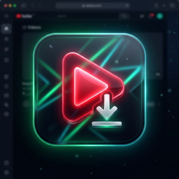

<div align="center">
  
  <h1>NexusTube v3.9.0</h1>
  <p><b>Next-Gen YouTube & Multi-Platform Music Suite & Studio Desktop Player</b></p>
  <p><i>Electron Edition · OLED Dark Glassmorphism · Local-first Download Site · by herlove</i></p>

  [](https://github.com/masuzu2/NexusTube/releases/latest)
  [](https://www.electronjs.org)
  [](https://github.com/yt-dlp/yt-dlp)
  [](#-ทดสอบ)
  [](LICENSE)
</div>

---

**NexusTube** คือเครื่องเล่นเพลง + ตัวดาวน์โหลดระดับสตูดิโอบน Windows สร้างด้วย **Electron** ดีไซน์ OLED Dark Glassmorphism สไตล์ Spotify / Apple Music รองรับการค้นหาและดาวน์โหลดจาก **YouTube, Spotify, Apple Music และ SoundCloud** ครบจบในแอปเดียว — พร้อมเว็บโหลดเพลงแบบ **Local-first** ที่รันบนเครื่องคุณเอง

## 📥 ดาวน์โหลด

| ไฟล์ | คำอธิบาย |
|------|----------|
| [NexusTube-Setup-3.9.0.exe](https://github.com/masuzu2/NexusTube/releases/latest/download/NexusTube-Setup-3.9.0.exe) | **ตัวติดตั้ง (แนะนำ)** — assisted installer เลือกภาษา ไทย/อังกฤษ, หน้า license, เลือกโฟลเดอร์, ปุ่ม Desktop + Start Menu |
| [NexusTube-3.9.0-Portable.exe](https://github.com/masuzu2/NexusTube/releases/latest/download/NexusTube-3.9.0-Portable.exe) | Portable — เปิดใช้ได้ทันที ไม่ต้องติดตั้ง |

> ทุกเวอร์ชัน: [Releases](https://github.com/masuzu2/NexusTube/releases) · เว็บไซต์ดาวน์โหลด: [masuzu2.github.io/NexusTube](https://masuzu2.github.io/NexusTube/)

## ✨ Features

### 🎵 เครื่องเล่นเพลงครบสตูดิโอ
- **คลังเพลงในเครื่อง** — สแกนอัตโนมัติ, ค้นหา, จัดการ playlist (M3U8)
- **ซับเนื้อเพลง Karaoke (LRC)** — เลื่อนตามจังหวะแบบเรียลไทม์, คลิกข้ามท่อนได้, ดึงจากไฟล์ `.lrc` / แท็กในไฟล์ / LRCLIB อัตโนมัติ, บันทึก `.lrc` ได้ในคลิกเดียว
- **5-Band Studio Equalizer** — ปรับละเอียด ±15dB พร้อมเส้นตอบสนองความถี่แบบเรียลไทม์ และ 8 presets (Bass Boost, Vocal, Club, Rock…)
- **Spectrum Visualizer** — กราฟิกคลื่นเสียง 16 แท่ง 60 FPS ตอบสนองจังหวะและความดัง
- Sleep Timer, Shuffle / Repeat, Anti-Jitter Seek, ธีมสี Accent เปลี่ยนได้ 6 แบบ

### 📥 ดาวน์โหลดแบบครบวงจร
- **Multi-Platform Resolver** — วางลิงก์ Spotify (Track/Album/Playlist), Apple Music, SoundCloud ได้เลย พร้อมเลือกแทร็กลงคิวแบบ batch
- **คิวดาวน์โหลดเรียลไทม์** — MP3 320k / M4A / FLAC / MP4 (สูงสุด 1080p) พร้อม thumbnail, ความเร็ว, ETA, ยกเลิก/ลองใหม่
- **Smart Tagger** — เก็บชื่อเพลงสะอาด (ตัด `[Official MV]`, `(Lyrics)` อัตโนมัติ), ฝัง cover art + metadata + เนื้อเพลงลงไฟล์
- **Zero Setup** — แอปดาวน์โหลด yt-dlp + ffmpeg มาตั้งค่าให้เองอัตโนมัติ

### 🌐 เว็บโหลดเพลง Local-first
- เปิดแอปทิ้งไว้ แล้วโหลดเพลงผ่านเบราว์เซอร์ที่ `http://127.0.0.1:8787` — ค้นหา → ใส่คิว → เปิดไฟล์
- ใช้ config และคิวตัวเดียวกับแอป ไม่ตีกันเอง · API ป้องกันด้วย token รับเฉพาะเครื่องตัวเอง
- รันแบบไม่เปิดหน้าต่างแอป: `NexusTube.exe --web-server` หรือ `START_WEB.bat`
- หน้า [portal บน GitHub Pages](https://masuzu2.github.io/NexusTube/) ตรวจจับเว็บในเครื่องให้อัตโนมัติ

### 🧰 อื่น ๆ
- 🎮 **Discord Rich Presence** — โชว์เพลงที่กำลังฟังบน Discord
- 📌 **System Tray + Global Hotkeys** — ควบคุมเพลงจากที่ไหนก็ได้
- ♻️ **Auto-Update** — แอปเช็คเวอร์ชันใหม่จาก GitHub Releases แล้วอัปเดตตัวเองพร้อม rollback safety

## 🚀 เริ่มใช้งาน

1. ดาวน์โหลด [NexusTube-Setup-3.9.0.exe](https://github.com/masuzu2/NexusTube/releases/latest/download/NexusTube-Setup-3.9.0.exe) แล้วติดตั้ง (เลือกภาษาไทยได้ในตัวติดตั้ง)
2. เปิด NexusTube — เครื่องมือโหลด (yt-dlp/ffmpeg) จะถูกจัดการให้อัตโนมัติ
3. โหลดเพลงจากในแอป หรือเปิด `http://127.0.0.1:8787` ในเบราว์เซอร์ขณะแอปทำงานอยู่

ไฟล์เพลงเก็บที่ `Downloads\NexusTube` (เปลี่ยนได้ในหน้าเว็บโหลด)

## 🛠 Build from Source

```bash
git clone https://github.com/masuzu2/NexusTube.git
cd NexusTube
npm install
npm start        # รันแบบ dev
npm test         # ชุดทดสอบ 37 รายการ
npm run dist     # build ตัวติดตั้ง NSIS + Portable ไปที่ dist_electron/
```

ต้องมี [Node.js](https://nodejs.org) 18+ และ Windows 10/11

## 📁 โครงสร้างโปรเจกต์

```
index.js              # Electron entry — หน้าต่างหลัก, tray, updater, เว็บโหลด in-process
src/main/             # โมดูลฝั่งหลัก
  ├── bridge.js       #   IPC bridge (NexusBridgeAPI)
  ├── player.js       #   เครื่องเล่น + equalizer + sleep timer
  ├── library.js      #   สแกน/จัดการคลังเพลง
  ├── lyrics.js       #   เครื่องยนต์ LRC
  ├── resolver.js     #   ค้นหา/แยกลิงก์หลายแพลตฟอร์ม + title sanitizer
  ├── downloader.js   #   คิวดาวน์โหลด (yt-dlp)
  ├── engine.js       #   จัดการ yt-dlp/ffmpeg อัตโนมัติ
  ├── config.js       #   ค่าตั้ง + ธีม + locale
  ├── discord.js      #   Discord Rich Presence
  ├── tray.js         #   System tray + hotkeys
  ├── updater.js      #   Auto-update พร้อม rollback
  ├── web-download.js #   เว็บโหลดเพลง Local-first (127.0.0.1:8787)
  └── download-plan.js#   pure helpers ของคิวดาวน์โหลด
src/preload/          # Preload script (contextBridge)
web/                  # UI (index.html = แอปหลัก, download.html = เว็บโหลด)
tests/                # ชุดทดสอบ node:test
```

เอกสารเพิ่มเติมใน [docs/](docs/) · ประวัติทุกเวอร์ชันที่ [CHANGELOG.md](CHANGELOG.md)

## 🧪 ทดสอบ

37 รายการผ่านทั้งหมด — ครอบคลุม IPC contract, config, resolver, LRC, library scanner, equalizer, คิวดาวน์โหลด, self-healing engine และ edge cases

```bash
npm test
```

## 📄 License

[MIT](LICENSE) — สร้างโดย **herlove**
